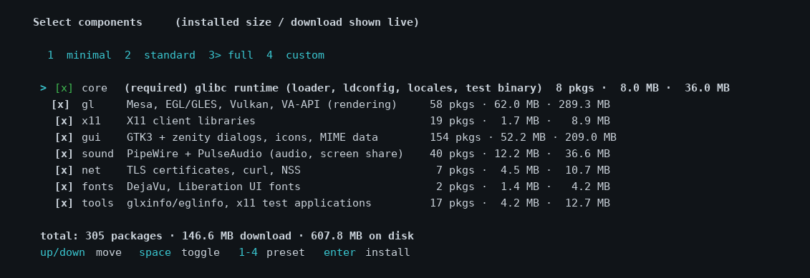

# glenv — glibc subsystem on Alpine/musl

[](https://github.com/angyedz/glenv/actions/workflows/ci.yml)
[](LICENSE)
[](https://alpinelinux.org/)

Run **glibc programs** on Alpine/musl without chroot or containers:
full Debian trixie userspace (glibc 2.41, GTK, sound, GL/EGL, TLS) + `glenv` router.

## Quick start

```sh
git clone https://github.com/angyedz/glenv.git
cd glenv
sh install.sh
```

Supported and tested target: Alpine Linux 3.20+ on x86_64 (musl); CI exercises
Alpine 3.20 through 3.24. ARM64/aarch64 support is **incomplete and
experimental**: installer changes are in progress, and the full install,
runtime, uninstall and VM test cycle has not been validated. Do not rely on it
for production. OpenRC is the tested init system; on other init systems the
installer writes fstab entries but you must arrange to mount them at boot.

One self-contained file (POSIX sh / BusyBox ash — no Python or Go required to
install), a component menu, a plan screen before any `sudo`, and byte-accurate
progress bars. The full preset downloads ~147 MB of Debian packages. The
installer verifies Debian's signed `InRelease`, codename, architecture, optional
`Valid-Until`, and the `Packages.xz` size and SHA256 before resolving or
downloading packages. Cached indexes are re-verified and expire after 24 hours;
every `.deb` is then checked against its authenticated package-index SHA256.



## Model: two userspace systems, ELF-level routing

- **musl** — Alpine host system, works as before.
- **glibc** — lives only in the `/opt/glibc-env` prefix, does not touch musl system files.
- **Router** — each binary carries a tag (PT_INTERP): at `execve` the kernel routes
  a glibc program to the architecture-specific glibc loader, musl ones to the musl loader.
  Our subsystem installs the real glibc loader + `/etc/ld.so.cache` with paths
  into the prefix → `./Randomglibcbinary` works **without flags**.
- `glenv run --sandbox=... --as=...` flags remain for policies (sandbox, run-as).

## Install on any Alpine (one script)

```sh
sh install.sh
# or with another prefix: GLENV_PREFIX=/data/glibc-env sh install.sh
```

The installer runs nine transparent stages:

1. **Preflight** — host report (musl/alpine, loader, DE, Wayland/X11, GPU),
   tools check, download, dependency resolution — all without root.
2. **Components** — arrow-key menu with checkboxes and presets
   `1 minimal / 2 standard / 3 full / 4 custom`; every group shows its live
   package count and sizes. Non-interactive: `--yes` or `--components=core,gl`
   or a piped line (`echo 2 | sh install.sh`).
3. **Plan before sudo** — the full list of system changes (loader, fstab,
   ld.so.conf, ld.so.preload, profile.d, symlink, mounts, apk packages) plus
   exact package counts/sizes/disk — confirmed with `[y/N]`; nothing is
   touched before that.
4. **Privileges** — one sudo authentication, apk dependencies.
5. **Packages** — per-package byte progress bar + overall bar with speed and
   ETA, `.part` + rename, stall watchdog with resume, cached/extracted states,
   SHA256 verification of every package.
6. **glenv** — router build (or prebuilt binary) + Wayland filter shim.
7. **System** — loader, bind mounts, `ldconfig`, locales, GTK/SSL caches.
8. **Verify** — health checks + `glenv doctor`.
9. **Done** — summary.

`tools/install.sh` is a compatibility wrapper for the same installer.
All flags and environment variables: [docs/INSTALLER.md](docs/INSTALLER.md).

## Uninstall

```sh
sh install.sh --uninstall          # remove system integration, keep the prefix
sh install.sh --uninstall --purge  # ... and delete /opt/glibc-env as well
```

The uninstaller shows the same plan screen before touching anything: it
unmounts the binds, drops the `/etc/fstab` lines, removes the glibc loader
(restoring the gcompat shim it displaced, if any), cleans `ld.so.cache`,
the preload filter line, `profile.d`, the `glenv` symlink and empty mount-point
dirs — then verifies every removal. `apk` packages are left alone (they are
harmless). Without `--purge` your sysroot stays in place, so re-installing is
fast; the summary prints the one-liner to restore the PATH symlink.
For safety, `--purge` only deletes a prefix carrying the installer's
`.glenv-prefix` ownership marker. Older prefixes without that marker are
uninstalled normally but deliberately retained.

## What the subsystem touches on the musl system (entry points only)

| Path | What |
|---|---|
| `/lib/ld-linux-x86-64.so.2` | real glibc loader (gcompat shim → `*.gcompat-shim`) |
| `/etc/ld.so.cache`, `/etc/ld.so.conf.d/glibc-env.conf` | glibc cache (musl ignores it) |
| `/etc/fstab` | 7 bind mounts `… → /opt/glibc-env/sysroot/…` |
| `/usr/lib/x86_64-linux-gnu`, `/lib/x86_64-linux-gnu`, `/usr/lib64`, `/usr/lib/locale`, `/usr/lib/ssl`, `/usr/share/{i18n,glvnd,drirc.d}` | empty mount points |
| `/usr/local/bin/glenv` | router (symlink into prefix) |
| `/etc/profile.d/glibc-env.sh` | `/opt/glibc-env/bin` in PATH |
| `/etc/ld.so.preload` | glenv Wayland filter shim (glibc only — musl never reads this file) |

Everything else glibc-related stays inside `/opt/glibc-env` (sysroot, debs, tools, src, lib).
The mount map and the full install/uninstall story: [docs/ARCHITECTURE.md](docs/ARCHITECTURE.md).

## Wayland: explicit sync without fences would freeze the frame

`glenv`'s GL stack (Mesa on **nouveau**) cannot export a native fence file
descriptor — `pipe_screen.caps.native_fence_fd` is never set, nouveau fences are
plain CPU sequence counters with no kernel `dma_fence` behind them. So
`EGL_ANDROID_native_fence_sync` does not exist here.

A compositor such as KWin still advertises `wp_linux_drm_syncobj_manager_v1`.
Chromium takes that as "explicit sync works", selects the `kSyncobj` method and
then stops installing a `wl_buffer.release` listener. It waits instead for an
acquire fence that this GL stack can never produce: buffers are attached without
a release point, `submitted_buffers` never empties, `MaybeProcessSubmittedFrames`
stops, the display scheduler throttles and the renderer starves — a **permanently
black window with frozen `requestAnimationFrame`**.

glenv fixes that on its side, in `lib/glenv-wayland-filter.so` (source:
`src/shim/glenv-wayland-filter.c`), preloaded for every glibc program through
`/etc/ld.so.preload`. The library interposes `recvmsg()` on the Wayland display
socket, walks the message framing (`sender_id` + `size<<16|opcode`) and rewrites
that one interface name inside complete messages with an equal-length decoy.
Nothing is dropped, so sizes, framing and stream position are untouched; the
client just compares against a name it does not know, never binds the manager,
falls back to `kDMAFence` and renders normally through `wl_buffer.release`.
Incomplete trailing messages are buffered until the rest arrives (they could not
be used anyway), and if framing ever fails to validate the connection switches
to pass-through instead of risking corruption.

Nothing here is application-specific — it applies to every glibc Wayland client.
Set `GLENV_WAYLAND_FILTER_DEBUG=1` to log the filter's activity on stderr.

## PipeWire: screen sharing stops right after the picker

Screen share on Wayland is a two-stage handshake: the picker is pure D-Bus
(`org.freedesktop.portal.ScreenCast`, served by the musl portal), but once a
source is chosen the *glibc* client must open its own PipeWire connection to the
host musl daemon and consume the stream.

`libpipewire` is only a thin library — the protocol itself lives in modules it
dlopen()s from `LIBDIR/pipewire-0.3`. Debian ships those in a separate package
(`libpipewire-0.3-modules`) that was missing from the sysroot, so every glibc
client failed inside `pw_context_new()`: the picker worked, the stream was
already dead on selection. Screen sharing would start and stop immediately.

glenv ships `libpipewire-0.3-modules` (and `pipewire-bin` for diagnostics), so
the handshake completes. Client/daemon versions do not need to match: the glibc
client is 1.4.2, the musl daemon is 1.6.8, and they negotiate fine.

## Check

```sh
glenv doctor
/opt/glibc-env/sysroot/usr/bin/hello        # direct launch, no flags
/opt/glibc-env/sysroot/usr/bin/glxinfo -B   # accelerated GL
/opt/glibc-env/sysroot/usr/bin/pactl info   # sound via PipeWire
/opt/glibc-env/sysroot/usr/bin/curl https://example.com  # TLS
/opt/glibc-env/sysroot/usr/bin/pw-cli ls Node   # PipeWire client (screen share path)
```

## Troubleshooting / FAQ

**`bash: ...: No such file or directory` (rc=127) on a glibc binary**
The `/lib64/ld-linux-x86-64.so.2` symlink is missing (Debian binaries use that
PT_INTERP). Re-run `sh install.sh` (stage 7 recreates it) or
`tools/integrate-system.sh`.

**gcompat is installed / I had a loader there before**
The installer keeps the file it displaces as `*.gcompat-shim`;
`--uninstall` restores it. musl never reads `/lib/ld-linux-x86-64.so.2`, so the
coexistence is silent.

**Discord / Chromium screen share starts and stops instantly**
Missing PipeWire protocol modules — install the `sound` component
(`sh install.sh --components=sound`), then re-run
`tools/integrate-system.sh`.

**Window is black on Wayland**
The explicit-sync filter must be in `/etc/ld.so.preload` — check with
`grep glenv /etc/ld.so.preload`, re-run `tools/integrate-system.sh`.
Debug: `GLENV_WAYLAND_FILTER_DEBUG=1 <app>`.

**TLS / certificate errors inside glenv**
The `net` component installs `ca-certificates`; re-run the installer if you
skipped it.

**`sudo` prompts during re-install / automation hangs**
Run once interactively, or export `SUDO_ASKPASS` — the installer saves a
working askpass helper in `$HOME/.glenv/askpass.sh` on first authentication.

**Can I move the prefix?**
Yes: `GLENV_PREFIX=/somewhere sh install.sh` installs into a dedicated absolute
path (letters, digits, `/`, `.`, `_`, `-` only). `glenv` locates its sysroot
relative to its own binary.

**How do I add extra Debian packages?**
`tools/fetch-deps.py [--update] package...` pulls them into the sysroot
after checking signed Debian metadata, dependency versions, and each archive
before applying the staged files. The helper keeps a transaction history:
`tools/fetch-deps.py history` lists updates and
`tools/fetch-deps.py rollback [transaction-id]` restores the latest active
transaction. Run `tools/integrate-system.sh` after an update to refresh `ld.so.cache`.

## Repository structure

```
glenv/
├── install.sh                self-contained installer (9 stages)
├── bin/glenv                 prebuilt router binary (Go, src/glenv)
├── lib/glenv-wayland-filter.so  prebuilt Wayland filter (src/shim)
├── src/glenv/                router sources (run, doctor, desktop, tui)
├── src/shim/                 Wayland explicit-sync filter (C)
├── tools/                    integrate-system, fetch-deps, compat wrapper
├── tests/                    clean-room chroot, pty menu test, static scans
├── docs/                     installer & architecture references
├── sysroot/  debs/           generated — Debian userspace + .deb cache (git-ignored)
└── .github/workflows/ci.yml  static + menu + clean-room jobs
```

## Rebuilding the prebuilts

```sh
# router
cd src/glenv && go build -trimpath -ldflags '-s -w' -o ../../bin/glenv .

# Wayland filter
gcc -shared -fPIC -O2 -nostdlib -o lib/glenv-wayland-filter.so \
    src/shim/glenv-wayland-filter.c
```

`install.sh` prefers building from source when a toolchain is present and
falls back to the prebuilt binaries shipped in the repository.

## Testing

```sh
sh tests/scan.sh              # syntax + English-only + no personal data (no root)
python3 tests/menu-pty.py     # interactive menu through a pty (arrows, plan, cancel)
sh tests/chroot-cleanroom.sh   # full install → verify → uninstall → purge in a pristine Alpine (sudo)
```

All three run in CI on every push ([.github/workflows/ci.yml](.github/workflows/ci.yml)).

## License

GPL-3.0-only — see [LICENSE](LICENSE). The Debian packages downloaded by the
installer remain under their own licenses; this project only fetches and
verifies them through Debian's signed release metadata and package SHA256 hashes.

**Disclaimer:** this is not an official Alpine or Debian project. It replaces
the system dynamic loader entry point — read the plan screen, and use
`--uninstall` if you want your system back exactly as it was.
